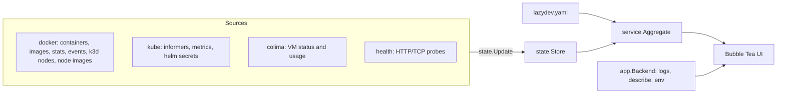

# lazydev design

Date: 2026-10-21
Status: Approved for phase 1 (observe)

## Purpose

`lazydev` is a terminal UI, in the spirit of lazydocker and k9s, for the local
development stack: a Docker engine (Colima on macOS), Docker Compose
infrastructure, and a local k3d cluster. It answers three questions quickly:

1. Is my stack healthy, and if not, which service is broken and why?
2. What is that service logging right now (or logged before it crashed)?
3. Is the cluster running the image I just built?

The core is generic. Project knowledge (which deployments, containers, images
and health URLs together form a "service") lives in a `lazydev.yaml` that the
project commits. Without a config, lazydev discovers services automatically.

## Scope

Phase 1 (this spec, implemented): observe only.

- Dashboard header: Docker engine VM CPU/memory/disk (Colima), k3d cluster
  status, Compose project status, service health counts.
- Logical services as the main view; raw resource views via a `:` palette.
- Detail tabs: Logs, Events, Describe, Env, Stats.
- Logs: follow, search, merged multi-pod streams, JSON pretty-printing, level
  filter, collapsed stack traces, previous-container logs, interleaved
  Kubernetes events.
- Images view with drift detection between local images, images imported into
  the k3d nodes, and images running in pods.
- CPU/memory for pods, containers, k3d nodes and the engine VM.
- HTTP/TCP health probes.
- Problem highlighting (CrashLoopBackOff, ImagePullBackOff, OOMKilled, Evicted,
  Pending, disk pressure, engine disk above 80%).

Phase 2 (actions) and phase 3 (dev loop, stack lifecycle) are out of scope for
this spec. The config already accepts a `build` block so phase 3 does not need
a config migration; phase 1 ignores it.

## Decisions

| Topic | Decision |
|-------|----------|
| Language / TUI | Go, Bubble Tea v1, Lipgloss, Bubbles |
| Docker | Docker Go SDK. Host resolved from `DOCKER_HOST`, `DOCKER_CONTEXT`, or the current Docker CLI context (so Colima works without `/var/run/docker.sock`). |
| Kubernetes | client-go informers (watch, not poll) plus the metrics API (`metrics.k8s.io`, included in k3s) |
| Helm | Releases decoded from Helm storage secrets (`owner=helm`) through the same informer machinery. This gives live updates without pulling the full Helm SDK dependency tree. |
| k3d | Derived from Docker container labels (`k3d.cluster`, `k3d.role`). No `k3d` CLI dependency. |
| Engine VM | `colima status --json` for allocation, `colima ssh` for live usage (`/proc/stat`, `/proc/meminfo`, `df`). Falls back to `docker info` totals when Colima is not in use. |
| Distribution | GoReleaser, GitHub releases on `github.com/swehacker/lazydev`, Homebrew cask in tap `swehacker/homebrew-tap` |
| Module path | `github.com/swehacker/lazydev` |

## Architecture



### Packages

- `cmd/lazydev`: flags (`--config`, `--context`, `--version`), wiring.
- `internal/config`: load, default and validate `lazydev.yaml`.
- `internal/model`: plain domain types (no SDK types leak into the UI) and the
  `Snapshot` struct.
- `internal/state`: `Store` holding the latest `Snapshot`. Sources send
  `Update` values; the store applies them and signals subscribers. Updates
  always replace sub-structures, never mutate them, so a snapshot is a cheap,
  race-free value copy. Also keeps short CPU/memory history for sparklines.
- `internal/source/docker`: container and image lists (refreshed on Docker
  events, debounced), container stats polling, k3d cluster derivation, and node
  image fingerprints (see drift).
- `internal/source/kube`: informers for pods, deployments, nodes, events and
  Helm secrets; metrics polling; reconnects with backoff when the cluster is
  down.
- `internal/source/colima`: engine VM status and usage.
- `internal/source/health`: probes on an interval, results keyed by service.
  `.local` hosts are resolved with Go's resolver (`/etc/hosts` first), because
  the macOS system resolver waits ~5s for multicast DNS before reading `/etc/hosts`.
- `internal/service`: joins config and snapshot into `LogicalService` rows with
  status rollup and drift.
- `internal/logs`: line parsing (JSON and plain), entries with grouped stack
  traces, ring buffer, and streamers for Kubernetes and Docker.
- `internal/app`: constructs sources and the `Backend` used by the UI for
  on-demand work (log streams, describe, env).
- `internal/ui`: root model, header, list panels, palette, detail tabs, log
  view, help.

Each source runs in its own goroutine and never blocks the UI. A failing source
marks its part of the snapshot unavailable with an error message shown in the
header; the rest of the UI keeps working.

## Configuration

Lookup order: `--config` flag, `./lazydev.yaml`, `<git root>/lazydev.yaml`,
`~/.config/lazydev/config.yaml`. Relative paths are resolved against the config
file's directory. No config file means auto-discovery mode.

```yaml
cluster:
  k3dName: dev                  # optional; derived from context k3d-<name>
  kubeContext: k3d-dev             # optional; defaults to k3d-<k3dName>, else current context
compose:
  project: dev-infra               # compose project label to show; empty = all projects
namespaces: [apps, infra]          # empty = all
health:
  interval: 10s
  timeout: 3s
  insecureSkipVerify: true         # local certificates
services:
  - name: api
    k8s: { namespace: apps, selector: app.kubernetes.io/name=api }
    image: api:local               # optional; inferred from the deployment
    health: https://api.example.local/actuator/health
    build: { dir: ../api, cmd: ... }   # phase 3, ignored now
  - name: postgres
    compose: postgresql            # compose service name
    health: tcp://localhost:5432
```

Validation: service names unique and non-empty; each service has `k8s` and/or
`compose`; `k8s.namespace` and `k8s.selector` required and the selector must
parse; `health` scheme is `http`, `https` or `tcp`; durations positive.

Auto-discovery (no `services`): one logical service per Deployment in the
watched namespaces (selector = the deployment's pod selector) and one per
Compose service in the watched project.

## Logical service status

Each component yields a status; the service status is the worst component
status, ignoring components that are `Unknown` unless all are.

| Component | Healthy | Degraded | Down |
|-----------|---------|----------|------|
| k8s | ready pods = desired > 0 and no pod problem | some ready, or any pod problem | 0 ready with desired > 0, or scaled to 0 |
| compose | running, healthcheck healthy or none | running and starting/unhealthy | not running (exit code 0 shows as `Completed`) |
| health probe | 2xx/3xx or TCP connect | failing probe | n/a |

Pod problems: waiting reason in CrashLoopBackOff, ImagePullBackOff,
ErrImagePull, CreateContainerConfigError, CreateContainerError,
InvalidImageName; last termination OOMKilled; pod reason Evicted; phase Pending
for over 60 seconds. The first problem becomes the service's reason text.

## Image drift

Docker uses the containerd image store, so local image IDs are index digests
and cannot be compared with the config digests that pods report. lazydev
compares content instead:

1. Local fingerprint: `RootFS.Layers` (diff IDs) from `docker image inspect`.
2. Node fingerprint: `crictl inspecti -o json <ref>` executed in each k3d node
   container (Docker exec API), giving `rootfs.diff_ids` and the node image ID.
3. Running image: `containerStatuses[].imageID` of the service's pods.

| Drift | Meaning |
|-------|---------|
| `missing` | image not present locally |
| `not imported` | present locally, absent on at least one k3d node |
| `stale import` | node layers differ from local layers (rebuilt, not imported) |
| `not rolled out` | node has the new image, a pod still runs an older image ID |
| `in sync` | all match |

Drift is computed only for images that exist locally or are explicitly
configured (registry images are skipped). Node fingerprints refresh every 30
seconds and whenever a local image changes.

## UI

```
 lazydev  ctx k3d-dev  colima cpu 23% mem 11.2/16G disk 77%  k3d dev 1/1  compose 7/7  ● 24 ◐ 1 ✖ 0
┌ [1] Services ─────────────────────────┐┌ Logs │ Events │ Describe │ Env │ Stats ─────────────┐
│ ● order-service   1/1  0  CPU MEM ...  ││ 13:44:01 INFO  OrderController : created order 42     │
│ ◐ email-service   0/1  3  CrashLoop... ││ 13:44:02 ERROR KafkaConsumer   : failed ...           │
├ [2] Resources · pods · all ───────────┤│   ⤷ 37 stack lines (s to expand)                      │
│ platform/order-service-684...  Running ││                                                       │
└───────────────────────────────────────┘└───────────────────────────────────────────────────────┘
 ? help  : command  / filter  tab focus  [ ] tabs  z zoom  q quit
```

- Left: `[1] Services` (logical) and `[2] Resources` (raw; kind chosen with the
  palette). Right: detail tabs for the selected row.
- Palette commands: `pods`, `deploy`, `helm`, `compose`, `images`, `nodes`,
  `events`, `services`, `ns <name|all>`, `quit`. Tab completion and fuzzy
  prefix matching.
- Global keys: `q` quit, `?` help, `:` palette, `1`/`2` focus panel, `tab`
  cycle focus, `[`/`]` switch tab, `z` zoom detail, `r` re-probe health.
- List keys: `j`/`k`, `g`/`G`, `/` filter, `enter` focus detail.
- Log keys: `space` follow/pause, `/` search, `n`/`N` next/previous match, `F`
  only matching lines, `l` cycle minimum level, `s` expand stack traces, `p`
  previous container, `t` timestamps, `w` wrap, `e` events on/off, `G` jump to
  end and follow, `esc` back.

## Logs

- Sources: Kubernetes `GetLogs` (follow, tail 500, timestamps, previous) for
  every pod/container of the selection, Docker `ContainerLogs` (follow, tail
  500, timestamps, demultiplexed). Streams are cancelled when the selection
  changes.
- Merged streams are colored per source; the source prefix is shown when more
  than one source is active.
- Parsing: JSON objects are recognised by common keys (`level`, `severity`,
  `log.level`, `@l`; `message`, `msg`, `@m`; `logger`, `logger_name`;
  `stack_trace`, `exception`, `error.stack_trace`). Plain lines get a level
  from the first level keyword in the line prefix (Spring Boot default format).
- Continuation lines (leading whitespace, `at ...`, `Caused by:`, `... N
  more`) attach to the previous entry and are collapsed by default.
- Level filter cycles all, debug, info, warn, error. Lines without a level are
  shown up to the info filter.
- Kubernetes events for the selected objects are interleaved as `EVENT`
  entries.
- Buffer: 5000 entries per view.

## Error handling

- Docker unreachable: header shows `docker: unavailable (<error>)`; retries
  every 5 seconds.
- Cluster unreachable or context missing: header shows `kube: unavailable`;
  reconnect with exponential backoff up to 30 seconds.
- Metrics API missing: CPU/memory columns show `-`.
- Colima missing: engine section falls back to `docker info`.
- Log stream errors appear inline in the log view as `lazydev:` entries.

## Testing

- Unit tests: config loading and validation, Docker context resolution, pod
  status and problem detection, Helm secret decoding, k3d derivation, Colima
  output parsing, health prober (httptest), aggregation and status rollup,
  drift classification, log parsing and stack grouping, store snapshot
  semantics, palette parsing.
- `go vet`, `golangci-lint`, `go test -race ./...`.
- Manual verification against a running local k3d cluster.
